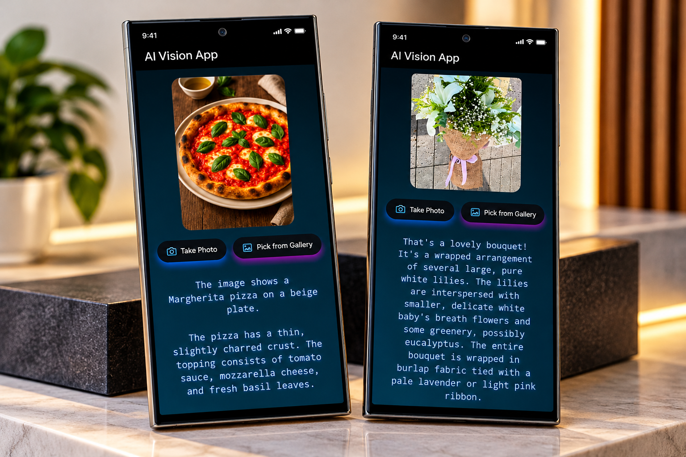

<div align="center">

# 🤖 AI Vision App

### Flutter • Dart • Artificial Intelligence • Computer Vision

**Transform Product Images into AI-Generated Descriptions**

An AI-powered Flutter application that generates
product descriptions from images, helping users
create engaging content for clothing, food,
sweets, accessories, and other products.


</div>

---

## 📸 Project Preview

<div align="center">

<a href="4a99bdfe-5ed0-455f-b0ad-ba5bce6db987.png">
  
</a>

</div>

---

## 📖 About the Project

**AI Vision App** is an artificial intelligence
application developed using Flutter and Dart.

The application uses AI-powered image analysis
to generate descriptive text based on product images.

Instead of manually writing product descriptions,
users can provide an image and receive
AI-generated content describing the product.

The project focuses on combining mobile
application development with artificial
intelligence to simplify content creation.

### 🎯 Use Cases

- 🛍️ E-commerce product descriptions.
- 👕 Clothing and fashion products.
- 🍔 Food and restaurant products.
- 🍰 Sweets and desserts.
- 💍 Accessories and lifestyle products.
- 📱 Digital product catalogs.

---

## ✨ Key Features

### 🖼️ Image-Based Input

- Provide a product image for analysis.
- Visual product input interface.
- Image-based AI processing.

### 🤖 AI Product Description Generation

- Analyze product images using AI.
- Generate relevant product descriptions.
- Convert visual information into text.
- Simplify product content creation.

### 🛍️ Multiple Product Categories

Supports description generation for:

- Clothing.
- Food.
- Sweets.
- Accessories.
- Other supported product images.

### 📝 Content Generation

- Generate descriptive product text.
- Present AI-generated results.
- Support product listing workflows.
- Reduce manual description writing.

### 📱 Flutter User Interface

- Mobile-friendly design.
- Image preview interface.
- AI-generated text display.
- Responsive Flutter layouts.

---

## 🛠️ Technologies Used

| Technology | Purpose |
|------------|---------|
| Flutter | Cross-platform UI |
| Dart | Application development |
| Artificial Intelligence | Description generation |
| Computer Vision | Image understanding |
| AI Integration | Image-to-text processing |
| Git & GitHub | Version control |

> The specific AI model or API depends on
> the implementation used in the source code.

---

## 🏗️ System Architecture

The application follows an image-to-text
generation workflow.

```text
          AI Vision App
                |
                v
         Flutter Interface
                |
                v
         Product Image
                |
                v
       Image Input Handling
                |
                v
       AI Vision Processing
                |
                v
     Product Image Analysis
                |
                v
     Description Generation
                |
                v
       Generated Text UI
```

---

## 🔄 How It Works

### Step 1 — Provide an Image

The user provides a product image through
the application's supported input method.

### Step 2 — Image Processing

The image is prepared for the AI processing
workflow.

### Step 3 — AI Analysis

The AI analyzes visible product information,
such as appearance, colors, and product type.

### Step 4 — Description Generation

The AI generates a natural-language
description based on the image.

### Step 5 — Display Results

The application displays the generated
description to the user.

---

## 💡 Example Use Case

### Input

A product image showing a red jacket.

### Example AI Output

"Stylish red jacket featuring a modern
design and a vibrant color, ideal for
creating a fashionable everyday look."

This is an illustrative example;
actual results depend on the AI model
and the uploaded image.

---

## 🚀 Getting Started

### Prerequisites

Make sure you have installed:

- Flutter SDK.
- Dart SDK.
- Android Studio or VS Code.
- Git.
- Access to the AI service used by the project.

### 1. Clone the Repository

```bash
git clone <YOUR_AI_VISION_REPOSITORY_URL>
```

Replace the placeholder with your
actual GitHub repository URL.

### 2. Navigate to the Project

```bash
cd <YOUR_PROJECT_FOLDER>
```

### 3. Install Dependencies

```bash
flutter pub get
```

### 4. Configure AI Integration

Configure the AI service used by the project.

Depending on your implementation,
configuration may include:

- AI service endpoint.
- API authentication.
- Image input processing.
- Request and response handling.
- Required environment configuration.

**Security:** Do not commit private API
keys to GitHub or embed secret API keys
directly in a distributed Flutter app.

Use a secure backend when the AI service
requires confidential credentials.

### 5. Run the Application

```bash
flutter run
```

The application requires a correctly
configured AI integration to generate
descriptions successfully.

---

## 🎯 Project Goals

- Combine Flutter with artificial intelligence.
- Generate product descriptions from images.
- Simplify content creation for online stores.
- Explore computer vision applications.
- Build an intuitive AI-powered mobile interface.

---

## 💡 Development Highlights

This project demonstrates experience in:

- Flutter application development.
- AI-powered application workflows.
- Image-based input handling.
- Integrating AI capabilities into mobile apps.
- Displaying dynamically generated content.
- Building practical AI-assisted tools.
- Developing responsive user interfaces.

---

## 🔮 Potential Future Improvements

- Multi-language description generation.
- Different writing tones.
- SEO-friendly product descriptions.
- Product title generation.
- Copy and export functionality.
- Description history.
- Batch image processing.
- Integration with e-commerce platforms.

---

## 👨‍💻 Developer

**Ahmed Jaber Ahmed**

Flutter Developer | Mobile App Developer

B.Sc. Computer Science & Artificial Intelligence

📍 Cairo, Egypt

- [GitHub](https://github.com/AhmedJaberAhmed)
- [Portfolio](https://ahmedjaberahmed.github.io/Jaber-website/)
- [LinkedIn](https://www.linkedin.com/in/ahmedjaberahmed/)

---

<div align="center">

### ⭐ Support the Project

If you find this project interesting,
consider giving it a star!

**Built with Flutter 💙 and AI 🤖**

</div>
